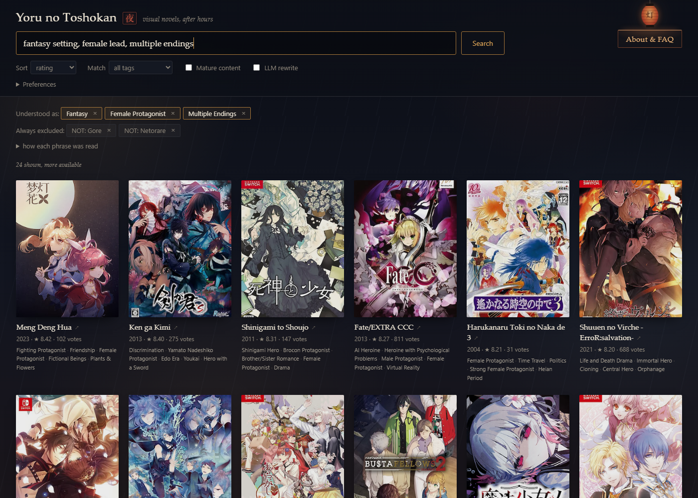
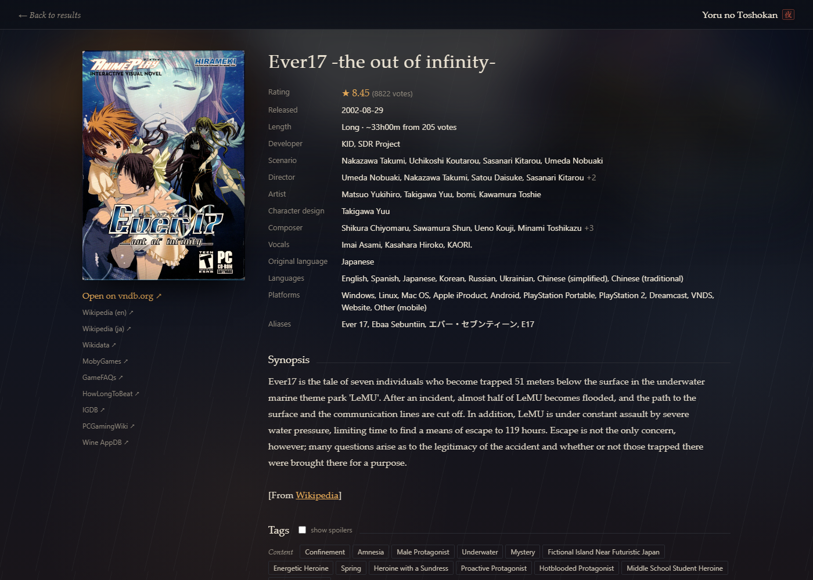

# Yoru no Toshokan &nbsp;夜の図書館

Search visual novels ([VNDB](https://vndb.org)) and light novels ([AniList](https://anilist.co)) by describing what you want.

**[Try it online →](https://wideindeed.github.io/Yoru-no-toshokan/)** &nbsp;(all ages; adult titles are desktop only)

> fantasy setting, female lead, multiple endings
>
> something about vampires made in RPG Maker, no horror, after 2015



## Features

- Plain-sentence search: tags, nicknames, language, engine, platform, length, year, rating, and exclusions ("no horror")
- Every parsed term is shown as a removable label; anything not understood is flagged
- Detail pages with tags, staff, screenshots and related titles
- Browse shelves, tag browser, title search, and shareable URLs
- Per-mode tag blocklist and hidden titles
- Light novel mode via AniList



## Run locally

Requires Python 3.10+.

```sh
git clone https://github.com/wideindeed/Yoru-no-toshokan.git
cd Yoru-no-toshokan
python -m venv .venv
.venv/bin/pip install -r requirements.txt   # Windows: .venv\Scripts\pip
.venv/bin/python app.py                     # Windows: run.bat
```

Open <http://127.0.0.1:5050>. The first start downloads VNDB's tag list (about a minute).

The desktop version has a **Mature** switch: off hides all sexual content, on shows only it.

## Configuration

- `config.yaml`: page size, sort, typo tolerance, blur, cache, port
- `parsing/synonyms.yaml`: add your own nicknames for tags
- Optional: `use_llm: true` rewrites long requests with a local [Ollama](https://ollama.com) model; `use_embeddings: true` adds fuzzy matching (needs `sentence-transformers`)

## Command line

```sh
python cli.py "highly rated mystery with time loops"
python cli.py "fantasy, english" --sort votecount -n 20 --any --explain
```

## Web build

`web/` is a static version for GitHub Pages that runs the same parser in the browser via [Pyodide](https://pyodide.org).

```sh
python build_web.py
python -m http.server -d site
```

## Development

```sh
python -m pytest -q          # offline
python -m pytest -q --live   # hits the real API
```

## License

MIT. Unofficial fan project, not affiliated with VNDB, AniList, or any publisher. Uses only their public APIs, with rate limiting and caching. VNDB data is under the [ODbL](https://vndb.org/d17#4); artwork belongs to its owners. Please keep forks non-commercial.
